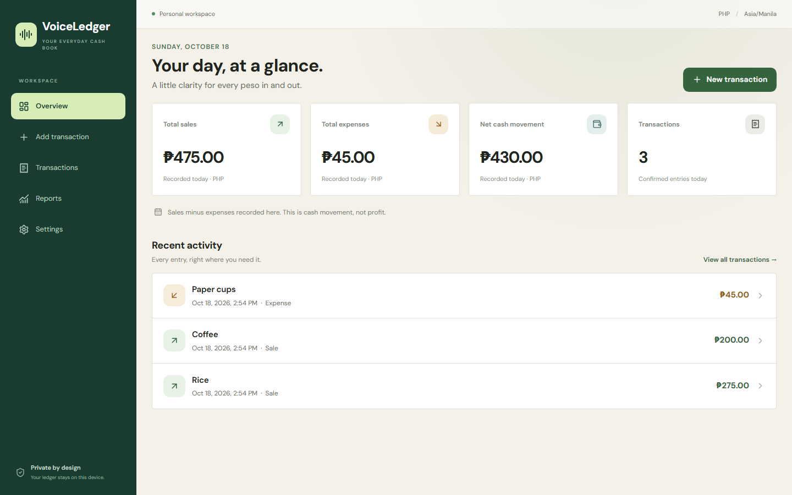

# VoiceLedger

VoiceLedger is a local-first, single-user ledger for small sellers. Speak or type a sale or expense, review every field, and explicitly confirm before anything is stored. It uses PHP and reports days in `Asia/Manila`.

## See it in action

[](docs/media/voiceledger-demo.mp4)

[Watch or download the full MP4 walkthrough](docs/media/voiceledger-demo.mp4).

The walkthrough uses fictional demo entries and shows the manual review workflow: type a transaction, review the text alongside the draft, confirm the details, and compare counted cash with the day's ledger. Voice transcription and local AI inference are not demonstrated in this recording.

<details>
<summary>Overview screenshot</summary>



</details>

To record an updated preview after building the app, run `node scripts/record-demo.mjs`. It requires Playwright Chromium and FFmpeg (`FFMPEG_PATH`, or `.local-tools/ffmpeg.exe`) and uses a separate temporary database.

## Requirements (Windows)

- Node.js 22 LTS (`node --version` must be 22.x)
- npm 11+
- Optional voice/AI: FFmpeg, whisper.cpp with a multilingual model, and Ollama with the configured model

## Install and run

```powershell
cd C:\VoiceLedger
Copy-Item .env.example .env
npm.cmd install
npm.cmd run dev
```

Open `http://127.0.0.1:5173`. Typed manual entry, ledger persistence, history, dashboard, CSV, and backup do not require AI. Development uses a Vite proxy; production uses one Express origin:

```powershell
npm.cmd run build
npm.cmd start
```

Open `http://127.0.0.1:4310`. The database defaults to `data\voiceledger.db`.

## Local AI setup

Install FFmpeg and Ollama:

```powershell
winget install --id Gyan.FFmpeg -e
winget install --id Ollama.Ollama -e
ollama pull qwen2.5:3b
```

Build whisper.cpp (requires Git, CMake, and Visual Studio C++ build tools):

```powershell
git clone https://github.com/ggerganov/whisper.cpp C:\tools\whisper.cpp
cmake -S C:\tools\whisper.cpp -B C:\tools\whisper.cpp\build
cmake --build C:\tools\whisper.cpp\build --config Release
Invoke-WebRequest https://huggingface.co/ggerganov/whisper.cpp/resolve/main/ggml-small.bin -OutFile C:\tools\whisper.cpp\models\ggml-small.bin
```

Set `.env` paths if they differ. Start Ollama bound to loopback only (its default on a local installation), then visit Settings to verify both services. The extraction model is configurable with `OLLAMA_MODEL`. VoiceLedger never sends input to cloud AI and never falls back to it.

English is the tested target. Filipino and mixed Bisaya-English are experimental; use the multilingual `ggml-small.bin`, not an `.en` model. Model speed depends on hardware and has not been benchmarked here.

## Commands

```powershell
npm.cmd run typecheck
npm.cmd test
npm.cmd run build
npx.cmd playwright install chromium
npm.cmd run test:e2e
```

Optional fictional demo data (with the production server running): `npm.cmd run demo:seed`. The seed is clearly marked and is never run automatically.

Core versions are locked in `package-lock.json`; the current verified set includes React 19.3, Vite 8.3, Tailwind CSS 4.3, Express 5.3, better-sqlite3 13.0, Zod 4.6, Vitest 5.0, and Playwright 1.64. `npm audit` reported zero known vulnerabilities when delivered.

## Troubleshooting

For a repeatable local AI accuracy check, run `npm.cmd run benchmark:ai`. It evaluates fictional transactions without saving ledger entries and writes a detailed report under `benchmarks/results/`. See [AI benchmark instructions](docs/ai-benchmark.md) for scoring rules and optional real-audio testing. A text-only run does not verify speech recognition.

- PowerShell blocks `npm.ps1`: use `npm.cmd` as shown.
- “Ollama is not reachable”: start the Ollama app/service, run `ollama list`, and confirm `OLLAMA_URL` remains a loopback URL.
- Missing model: run `ollama pull <OLLAMA_MODEL>` using the exact configured name.
- Speech unavailable: check `ffmpeg -version`, then verify `WHISPER_CLI` and `WHISPER_MODEL` are absolute existing paths.
- Microphone denied: allow microphone access for localhost in the browser, or use typed entry.
- Database locked: close other processes directly inspecting the database and retry. VoiceLedger uses WAL and a busy timeout.

## Scope and privacy

The app excludes inventory, customers, credit/utang, taxes, payroll, and multiple users. It assumes confirmed sales and expenses are paid immediately. Net cash movement is not profit. See [local production operation](docs/production.md) for release checks, automatic backups, safe recovery, updates, and limitations.

Audio is temporary and removed after processing. Confirmed transcripts are stored in the ledger. Unfinished text and edited drafts are kept in browser local storage for recovery and removed after successful confirmation or explicit discard. Browser recovery copies are not included in database backups. The database, backups, recovery copies, and local models are not encrypted at rest. This design assumes one trusted OS user. Do not bind it to a LAN; there is no authentication or multi-user security model.
